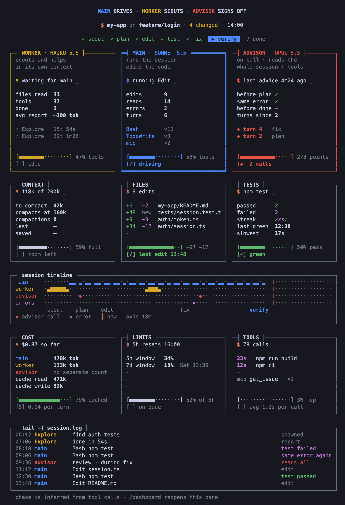

# agent-dashboard

**Sonnet drives, Haiku scouts, Opus signs off.** A Claude Code plugin that sets up that three-role split and shows it working in a live, retro-terminal dashboard pane.



*Screenshot drawn with demo data: the repo, branch and files are made up.*

## The three roles

| Role | Model | What it does | What the plugin does for it |
| --- | --- | --- | --- |
| **MAIN** | your session model, e.g. Sonnet | Runs the session and edits the code | Shows what it is doing, its edits, reads, errors and turns |
| **WORKER** | Haiku | `Explore` subagents that search the repo and docs, read-only | Runs `Explore` on Haiku unless the call names a model, and asks for a short report (`path:line` bullets, no pasted files), so less lands in the main context |
| **ADVISOR** | e.g. Opus | Claude Code's advisor: reads the whole session and reviews it | Tracks the three moments to ask (before a plan, after the same error twice, before done), and can add that rule to the system prompt |

The advisor itself is a Claude Code setting, not part of the plugin. To turn it on, set the model in `~/.claude/settings.json`:

```json
{ "advisorModel": "claude-opus-5-5" }
```

## What the pane shows

- **Header**: repo, branch, files git sees changed, session time
- **Stages**: `scout · plan · edit · test · fix · verify · done`, inferred from tool calls
- **MAIN · WORKER · ADVISOR**: what each is doing now, its counters, recent activity, share of tool calls. Each model is named once, in its card's title
- **CONTEXT**: window fill, tokens left before auto-compact, compactions
- **FILES**: files edited this session with `+added −removed` lines
- **TESTS**: passed and failed runs, streak, last green, slowest run. Only real test runners count (`npm test`, `pytest`, `vitest` …), not commands that just mention "test"
- **COST**: session total, tokens by role, cache hit rate, cost per turn
- **LIMITS**: plan rate-limit windows and whether use is ahead of the 5-hour window's pace (subscription plans)
- **TOOLS**: calls over 10 s, MCP tools used, average call time
- **Session timeline**: activity lanes for main, worker, advisor and errors
- **tail -f session.log**: the latest events
- **Band above the prompt**: a one-line summary while the pane is closed

Every number comes from real session events. Nothing is simulated.

The advisor runs inside the API request as a server tool, so no response reports its tokens separately. COST shows "no separate count" for it.

## Install

In a Claude Code terminal session:

```
/plugin install agent-dashboard --marketplace Shoulao/claude-agent-dashboard
```

Answer `y` to add the marketplace, then pick the user scope.

Or from any shell, with no session open:

```
claude plugin install agent-dashboard --marketplace Shoulao/claude-agent-dashboard
```

It installs for your user (every project) and adds this repo as a marketplace on the way. The pane opens when a session starts; `/dashboard` reopens it. With the pane focused, the arrow keys scroll it.

The plugin uses Claude Code's function hooks (mods), an early-access API: it needs a Claude Code build that has them.

## Options

| Option | Default | What it does |
| --- | --- | --- |
| `autoOpen` | `true` | Opens the pane when a session starts |
| `band` | `true` | Shows the one-line summary above the prompt while the pane is closed |
| `background` | `dark` | `dark` draws a dark retro screen; `theme` keeps the app's pane colour |
| `workerModel` | `haiku` | Model for `Explore` workers when the call names none: `haiku`, `sonnet`, or `inherit` to leave it to Claude Code. It is passed as the Agent call's model, which wins over a model set in your own `.claude/agents/Explore.md`; use `inherit` to keep yours |
| `conciseWorkers` | `true` | Asks `Explore` workers for a short report |
| `advisorRule` | `false` | Adds one system prompt line: consult the advisor only before a plan, after the same error twice, and before done. Leave it off if your `CLAUDE.md` already says this |

Change them from the config menu, or:

```
echo '{"workerModel":"inherit"}' | claude plugin configure agent-dashboard@agent-dashboard --values-stdin
```

Where an organization manages Claude Code, plugins a person installs don't run the system prompt and compaction hooks, so `advisorRule` and the compaction count do nothing there. Everything else works.

## Privacy

Everything stays on your machine. The plugin:

- keeps its counters in the session's own state, never in files
- runs one command, `git status --porcelain -b` (with `core.fsmonitor` off, so a repo's config cannot make it run a program), at session start and after each turn, for the header
- reads one setting, `advisorModel`, to name the advisor's model
- makes no network requests

## Develop

```
claude plugin validate .
claude plugin test .
```

Run a session with `claude --plugin-dir .` to load it from this folder; edits reload when the turn ends.

## License

MIT, see [LICENSE](LICENSE).
